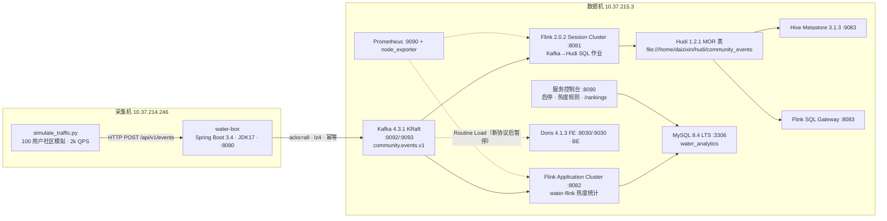

# 双机实时数据平台搭建工作总结（2026-10-12 ~ 2026-10-14）

> 范围：采集机 `10.37.214.246` + 数据机 `10.37.215.3`
> 业务背景：类 Figma 设计社区的埋点采集与作品/用户热度统计（小时、天、三天、周排行）。
> 说明：本文根据这几天的对话与操作记录整理。所有密码、令牌都已省略，只写存放位置。

---

## 1. 最终成果一览

### 1.1 整体架构

### 1.2 组件与端口清单（数据机 10.37.215.3）

| 组件 | 版本 | 端口 | 安装位置 / 管理方式 |
|---|---|---|---|
| JDK | OpenJDK 17 | – | `/usr/lib/jvm/java-17-openjdk-amd64` |
| Doris FE | 4.1.3 | 8030 (Web) / 9030 (MySQL 协议) / 9010 / 9020 | `/home/daizixin/doris/fe`，systemd `doris-fe` |
| Doris BE | 4.1.3 | 8040 / 9050 / 8060 / 9060 | `/home/daizixin/doris/be`，systemd `doris-be` |
| Kafka | 4.3.1（KRaft 单节点，无 ZooKeeper） | 9092 / 9093 | `/home/daizixin/kafka`，systemd `kafka` |
| Flink Session Cluster | 2.0.2 | 8081 | `/home/daizixin/flink`，systemd `flink-jobmanager` / `flink-taskmanager` |
| Kafka→Hudi 作业 | Hudi 1.2.1 | – | `/home/daizixin/flink-jobs/community-events-hudi`，systemd `flink-hudi-community-events` |
| water-flink Application Cluster | 2.0.2 | 8082 | `/home/daizixin/flink-apps/water-flink`，systemd `water-flink-jobmanager` / `water-flink-taskmanager` |
| MySQL | 8.4.11 LTS | 3306 | systemd `mysql`，配置 `/etc/mysql/mysql.conf.d/zz-flink-cdc.cnf` |
| Flink SQL Gateway | 2.0.2 | 8083 | systemd `flink-sql-gateway` |
| Hive Metastore | 3.1.3（Derby） | 9083 | `/home/daizixin/hive`，systemd `hive-metastore` |
| 服务控制台 | 自研 Python | 8090 | `/home/daizixin/service-panel/app.py`，systemd `service-panel` |
| Prometheus / node_exporter | apt 包 | 9090 / 9100 | 采集 Flink 指标和 Kafka lag |
| Grafana | 11.5.2 | 3000 | **未完成安装**（官方源下载太慢），Dashboard JSON 已准备好 |

采集机 `10.37.214.246`：

| 组件 | 说明 |
|---|---|
| water-box | Spring Boot 3.4.4 + JDK17，`POST /api/v1/events`，HTTP `8080`（暂不启用 TLS） |
| simulate_traffic.py | 有状态社区模拟器，`aiohttp` 长连接，默认 2,000 QPS、200 并发，运行在 `.venv` 中 |
| GitHub | `ZongPiCHa/water-box`、`ZongPiCHa/water-flink`（SSH key 认证） |

### 1.3 Kafka Topic 与消费组

| Topic / Group | 用途 |
|---|---|
| `community.events.v1`（3 分区） | 全部埋点事件 |
| `water.heat-score-config.v1`（compact） | 热度权重配置广播 |
| `flink-hudi-community-events-v1` | Kafka→Hudi 作业 |
| `water-flink-stats-v2` | water-flink 统计作业（从 earliest 重建） |
| `job_events_<uuid>` | Doris Routine Load 自动生成的消费组 |

---

## 2. 时间线与关键过程

### 阶段 1（10-12 下午）：数据机基础环境——Doris、Kafka

1. **确认架构**：`uname -m` 输出 `x86_64`，所有安装包都选 x64。
2. **JDK 17**：机器原本是 ByteOpenJDK 11。先用 `apt-get install openjdk-17-jdk` 安装，再用 `update-alternatives` 切换默认版本。
3. **Doris 4.1.3**：用脚本安装到 `/home/daizixin/doris`，1 FE + 1 BE。
   - `priority_networks = 127.0.0.1/32`，FE 元数据在 `doris-meta`，BE 数据在 `doris-storage`。
   - `ALTER SYSTEM ADD BACKEND "127.0.0.1:9050"`；`SHOW FRONTENDS/BACKENDS` 都显示 `Alive=true`。
   - Web UI 是 `:8030`，默认账号 `root`、密码为空。Playground 可以直接跑 SQL。
4. **Kafka 4.3.1（KRaft）**：按命令逐步安装到 `/home/daizixin/kafka`。踩坑如下：
   - 4.x 的配置文件在 `config/server.properties`，**没有** `config/kraft/` 目录。
   - `kafka-storage.sh format` 必须加 `--standalone`，集群 ID 必须由 `random-uuid` 生成，不能自己随便写。
   - 一键脚本因为下载中断，留下了 `kafka.bak.*` 目录和 `.tgz.1/.2/.3` 残缺文件，后来已经清理。
   - 创建 `community.events.v1`，3 分区，单副本。Kafka 会警告 Topic 名同时含点号和下划线可能导致指标冲突；当前名字只用了点号，可以忽略。
5. **GitHub**：生成 SSH key 并接入 GitHub。

### 阶段 2（10-12 晚）：采集机 water-box 与链路打通

1. **water-box**（Spring Boot 3.4.4 / JDK17）：
   - 接口为 `POST /api/v1/events`。只有收到 Kafka 确认才返回 `202`，失败返回 `503`。
   - Producer 配置：`acks=all`、幂等、`lz4`、`linger.ms=5`、`batch.size=64KB`、`buffer.memory=128MB`、`max.block.ms=5000`；Tomcat 400 线程，目标 QPS 为 1 万。
   - 没有证书，所以先临时用 HTTP `8080`；以后可以通过 `SERVER_SSL_ENABLED=true` 加 PKCS12 证书，或者在前面放 Caddy/Nginx 来提供 HTTPS。
   - README 已改成中文并推送。
2. **跨机写 Kafka 失败的排障**：
   - 现象：应用能连上 `10.37.215.3:9092`，但随后去连 `localhost:9092`。
   - 根因：Broker 的 `advertised.listeners` 还是 `localhost`。
   - 修复：改为 `PLAINTEXT://10.37.215.3:9092,CONTROLLER://10.37.215.3:9093`，然后重启。
3. **Kafka 重启后起不来**：日志报 `Socket server failed to bind to 0.0.0.0:9093: Address already in use`。原因是旧进程还没退出。等端口释放后，先前台启动确认出现 `Kafka Server started`，再改成后台运行。
4. **验证方法**：`kafka-get-offsets.sh` 查看高水位，`kafka-console-consumer.sh --from-beginning` 查看消息内容。

### 阶段 3（10-12 晚 ~ 10-13）：埋点协议与压测

1. **统一埋点协议**（14 个通用字段）：`timestamp`（13 位毫秒）、`log_id`、`session_id`、`span_id`、`pre_span_id`、`system`（front/backend）、`theme`、`action`、`user_id`、`team_id`、`username`、`env`（prod/test）、`properties`（自定义 Map）。
2. **社区模拟器**：模拟 100 个用户，行为包括浏览、点赞（后端）、评论（后端）、转发（前端）、关注（后端）、登录、发布作品。约 10% 的点赞和评论会在之后被取消或删除。用户可以改名、加入团队，以团队身份发布作品时带上 `team_id`。业务字段 `project_id/comment_id/author_user_id` 放在 `properties` 里。
3. **压测中发现的问题**：
   - 100 QPS 下请求全部超时：400 个 Tomcat 线程都卡在往 IDE 终端写 INFO 日志上。修复方式是把逐条埋点日志改写到滚动文件 `logs/events.log`（logback 配置，100MB × 7 天），之后 500 条/5 秒全部成功。
   - 只用标准库 `urllib` 时，最高只能到约 1,550~1,700 QPS。改用 `aiohttp` 长连接后，实测达到 2,000 QPS，6,000 条 3.00 秒发完，失败为 0。系统 Python 受 PEP 668 限制，所以改用 `.venv`。
   - 运行到 63 万条后速度降到约 600 QPS。原因有两个：同时开了两个模拟器进程；作品池不断变大，导致每条事件都要遍历全池做加权抽样。修复后活跃作品池固定为 1 万，抽样开销不再随数据量增长。
   - 关于“在途请求”：在途数 ≈ QPS × 平均延迟，这是异步发送的正常现象。`--concurrency` 起背压保护作用，不能去掉。

### 阶段 4（10-13）：Kafka→Doris、Flink、Hudi、控制台

1. **Doris Routine Load**：创建了 `demo.community_events` 表和 `job_events` 任务，按旧协议的 `eventId/eventType/...` 解析，`errorRows=0`。Routine Load 只能用 SQL 管理；8030 Web UI 不能图形化创建任务，要图形化需要另装 Doris Manager。
   - **遗留问题**：埋点改成新协议后，该任务已经暂停，表结构和 jsonpaths 需要按新字段重建。
2. **Flink 版本选择**：
   - 先装了 Flink 2.3.0，后来查证 **Hudi 不支持 Flink 2.3**：Hudi 1.2.1 只支持 Flink 1.17~1.20、2.0、2.1。
   - 于是卸载，改装 **Flink 2.0.2**（安装包通过 SHA-512 校验），配 Java 17。
3. **Hudi 安装**：在 `flink/lib` 放入以下 jar：
   - `hudi-flink2.0-bundle-1.2.1.jar`
   - `flink-sql-connector-kafka-4.0.1-2.0.jar`
   - `hadoop-client-api-3.4.2.jar`、`hadoop-client-runtime-3.4.2.jar`
   - `commons-logging-1.3.5.jar`（缺少它会报 LogFactory 找不到）
   - 已验证 COW 表建表、写入、查询都正常。
4. **Kafka 重启后写不进数据**：集群 ID 已经保存在 `kafka/data/meta.properties`（`pbQT_GDaQUWIZJLK6EcHFg`），不需要记住。**千万不要再执行 format。** 之后把 Kafka、Doris、Flink 都交给 systemd 管理并设为开机自启。
5. **服务控制台 `:8090`**：Python 标准库实现，监控 Doris FE/BE、Kafka、Flink 的状态，支持启动、停止、重启和全部启停，每 5 秒刷新。按你的要求已去掉密码登录。
6. **Kafka→Flink→Hudi 实时任务**：
   - `job.sql`：用 raw 格式读取 Kafka，`JSON_VALUE` 提取字段，过滤掉没有 `log_id` 的旧消息。
   - 写入 Hudi：`MERGE_ON_READ`，主键 `log_id`，按 `event_date` 分区，同时保留 `raw_event` 原文。Checkpoint 为 EXACTLY_ONCE。
   - `supervisor.py`：等集群就绪后提交 SQL；作业失败时自动重提；由 systemd 托管。
7. **Slot 调整**：1 → 4（TaskManager 内存 1728M → 4096M），这样实时任务运行时也能跑 Hudi 查询。
8. **认知梳理**：
   - Hudi 是表格式，不依赖 HDFS，可以落在本地 `file://`、HDFS 或 S3/MinIO 上。
   - Doris 要直接查 Hudi，需要 HMS 加共享存储，而且 Doris 内置的 Hudi 0.15 读取器和 table version 9 存在兼容风险。
   - 短期建议：Flink 同时写 Hudi（归档）和 OLAP（分析）。
   - Flink 部署模式：当前是 Standalone + Session；需要隔离的任务用 Application Mode。Flink 2.0 已经移除 Per-Job 模式。

### 阶段 5（10-13 夜 ~ 10-14）：water-flink 热度统计

1. **建项目**：`ZongPiCHa/water-flink`，运行在独立的 Standalone Application Cluster（`:8082`，独立端口、日志和内存）。日志改用 SLF4J（文件和 journald 各一份，100MB × 10 个滚动）。Web UI 的 Logs 页显示当前主日志，Log List 页列出全部历史文件。
2. **统计口径**：
   - 关注 6 种 action：`like/unlike/comment/delete_comment/share/follow`。
   - 用 keyed state 做抵消：点赞按 `actor+project`，评论按 `comment_id`，关注按 `actor+target`。另外用 `log_id` 去重。
   - 用户维度和作品维度分别统计（作品维度带作者 `user_id`），取窗口内的净变化，允许为负。
   - 窗口：分钟级被认为太细，最终定为 `HOUR / DAY / THREE_DAY / WEEK`，按北京时间对齐。允许迟到 5 分钟。
3. **MySQL 8.4 LTS**：通过官方 APT 源安装。开启 binlog ROW、GTID，为 CDC 做准备。
   - 账号：`water_flink`（只有 SELECT/INSERT/UPDATE 权限）、`water_datagrip`（只读）、`water_admin`（允许 `10.0.0.0/8` 内网访问的管理员）。
   - 密码文件：`~/.config/water-platform/*.env` 和 `flink-apps/water-flink/conf/analytics.env`，权限都是 0600。
4. **表设计**（`water-flink/sql/001_engagement_stats.sql`）：
   - `user_engagement_stats`、`project_engagement_stats`，主键为 `(window_type, window_start, 对象ID)`。**窗口本身就是版本**：今天的窗口持续 upsert，昨天和前天的行自然保留下来，作为兜底。
   - 热度相关：`heat_score` 和 `score_version`；规则表 `heat_score_rule` 带版本号，同一时间只有一条 ACTIVE；权重放大 1000 倍存为整数。
   - 写入采用完整快照 upsert，用 MySQL 8.4 的 `INSERT ... AS incoming ON DUPLICATE KEY UPDATE` 写法，**不要**写成 `col = col + x` 这种累加。
   - 保留策略由 Event Scheduler 定时清理：小时 24h、天 7d、三天 18d、周 8 周。
5. **动态热度规则**：在控制台修改权重，写入 MySQL 规则表，再发到 Kafka compacted topic，由 Flink Broadcast State 接收。收到后当前活动窗口立即按新规则重算，已关闭的历史窗口保持不变。当前规则 v3：点赞 1、评论 3、转发 5、关注 4。
6. **排行榜页面**：`http://10.37.215.3:8090/rankings`，展示各周期 Top5 作品，每 30 秒刷新。

### 阶段 6（10-14）：稳定性与性能排障

| 问题 | 根因 | 处理 |
|---|---|---|
| Hudi 作业 checkpoint 失败：`Size of the state is larger than the maximum permitted memory-backed state` | 默认 JobManager 内存 checkpoint，单状态上限 5MB | 改为 FileSystem checkpoint：`/home/daizixin/flink-state/session-cluster/{checkpoints,savepoints}`，超时 5min |
| water-flink checkpoint 超时、反压 99.9% | 8 路窗口在 Heap 状态下做全量快照，状态 80~100MB；并行度为 1 | 改用 RocksDB 增量 checkpoint；间隔 120s、超时 600s、容忍失败 3 次；新建消费组 `water-flink-stats-v2` 从 earliest 重建 |
| 修复后吞吐仍然追不上 | 8 条窗口链每分钟输出全部快照，放大成数千万次 MySQL upsert | 新增“脏窗口”触发器，只输出有新事件的窗口；并行度 2→6；JDBC 批量 1000。之后 lag 从 1424 万降到 1070 万并持续追赶 |
| 从 savepoint 恢复后作业连环 RESTARTING | trigger 状态类型从 REDUCING 改成了 VALUE，与旧状态不兼容 | 修复状态兼容后再从新 savepoint 恢复 |
| Hudi 作业 OOM（`HoodieAvroDataBlock.serializeRecords`） | 只有一个 writer，每 10 秒 checkpoint 一次，heap 只有 1.43GB | 并行度改为 4，compaction 2；writer 256MB/batch 64MB/log block 64MB；缓冲改用 MANAGED；checkpoint 60s；TaskManager 4G→12G |
| 排行榜 API 超时（215 万行） | `MAX(window_start)` 加 `ROW_NUMBER()` 导致全量排序 | 新增索引 `(window_type, score_version, window_start DESC, heat_score DESC, project_id)`，查询改成按索引直接 `LIMIT 5`，耗时从 10s+ 降到 0.91s |
| “Managed Memory 一直 100%” | RocksDB 会预占整个 managed 池，这是正常现象 | water-flink TaskManager 8G→12G；重启次数可用 `systemctl show -p NRestarts` 查看 |

### 阶段 7（10-14）：数据访问与监控

1. **DataGrip 连 MySQL**：最开始用 SSH 隧道加只读账号；后来改为开放内网访问，使用 `water_admin` 账号。
2. **DataGrip 连 Hudi**：通过 Flink SQL Gateway（REST `:8083`）加一个自研 JDBC 适配驱动 `DataGripFlinkDriver`。URL 为 `jdbc:flink-datagrip://127.0.0.1:18083/hudi_catalog/hudi?execution.runtime-mode=batch`，需要先建 SSH 隧道。
3. **Hive 路线**：
   - Hive Metastore 3.1.3 已在 `:9083` 运行，`community_events` 和 `community_events_rt` 已注册。
   - HiveServer2 3.1.3 在 JDK 11/17 上无法启动（`URLClassLoader` 强制转换缺陷），需要 JDK 8 或 Hive 4，**尚未完成**。
4. **监控**：
   - 已部署 Prometheus 和 node_exporter，两套 Flink 都开启了 Prometheus reporter（9249~9252），共 5 个 target 状态为 up。
   - Kafka lag 用一个 textfile 脚本每 30 秒采集一次；已配置告警规则：lag、TaskManager heap、主机内存。
   - Grafana 还没装好。

---

## 3. 遗留事项与建议

| 优先级 | 事项 |
|---|---|
| 高 | Doris Routine Load `job_events` 仍按旧协议暂停中，需要按新埋点字段重建表和导入任务（Skill 中已提供新协议版本） |
| 高 | 所有状态和数据都在本地磁盘（Hudi `file://`、checkpoint），单机故障会全部受影响；生产化需要迁到 HDFS/MinIO/S3 并配置 HA |
| 中 | Grafana 尚未安装；HiveServer2 需要 JDK 8 或升级 Hive 4 |
| 中 | Hudi 没有设置 ordering/precombine 字段，目前按提交时间排序；如需按事件时间合并，应改为 `timestamp` |
| 中 | Doris `priority_networks=127.0.0.1/32` 只能在本机注册 BE；改成多机时要用内网 IP 重新部署 |
| 中 | `water_admin` 权限很大，且对 10/8 开放；Doris `root` 密码为空；控制台没有登录认证，只适合在可信内网使用 |
| 低 | water-box 目前是 HTTP；上公网前需要证书或前置反向代理来提供 TLS |
| 低 | supervisor 重新提交作业时没有显式从 retained checkpoint 恢复，依赖 Kafka 已提交 offset 加 Hudi upsert 保证幂等 |

---

## 4. 沉淀的经验（Skill 中已固化）

1. **版本兼容先查清楚再装**：Flink 2.0.2 + Hudi 1.2.1（`hudi-flink2.0-bundle`）+ Kafka connector `4.0.1-2.0`。Flink 2.3 目前没有可用的 Hudi。
2. **Kafka 4.x KRaft**：配置在 `config/server.properties`；format 要加 `--standalone`，并且只做一次；`advertised.listeners` 必须写内网 IP。
3. **跨机通信看三处**：Kafka 的 advertised 地址、Doris 的 `priority_networks`、各 Web UI 的绑定地址（Flink `rest.bind-address`）。
4. **Flink 状态**：上线前就配置 FileSystem checkpoint 目录；状态大的作业用 RocksDB 增量 checkpoint；窗口输出只发有变化的窗口，避免写放大。
5. **高 QPS 服务不要往终端打逐条日志**；压测工具要用长连接，并设置背压上限。
6. **MySQL 结果表**：以窗口作为版本，写入用完整快照 upsert；排行榜查询必须有能覆盖它的复合索引。
7. **全部服务交给 systemd 管理**：开机自启、自动重启；用统一的控制台集中查看状态和启停。
