# water-flink 项目总览：社区实时数据链路全解析

> 版本：v1（2026-10-20）
> 仓库：`git@github.com:ZongPiCHa/water-flink.git`（分支 `main`）
> 定位：本文是 water-flink 的**唯一全景入口文档**，从外部数据基建讲到作业内部每个算子，
> 并**重点记录每一次遇到的问题与优化动作**。
> 说明：全文不包含任何数据库密码、令牌或凭据路径。

---

## 0. 文档地图

| 章节 | 内容 | 适合谁看 |
| --- | --- | --- |
| 1 | 项目定位与业务价值 | 所有人（先读这个） |
| 2 | 外部数据基建全景（机器 / 组件 / 端口 / Topic / 库表） | 运维、架构 |
| 3 | 端到端数据流（一条埋点的一生） | 所有人 |
| 4 | 作业内部算子拓扑（完整 DAG、UID、并行度） | 开发 |
| 5 | 评论风控：双流 Join + CEP 详解 | 开发、算法 |
| 6 | 热度规则版本化机制（MySQL→Kafka→广播状态） | 开发、产品 |
| 7 | 存储分层与下游消费 | 数仓、DBA |
| 8 | 部署、升级与回滚（Savepoint 运维） | 运维 |
| 9 | **问题与优化编年史（重点章节）** | 所有人 |
| 10 | 监控与告警 | 运维 |
| 11 | 测试体系 | 开发 |
| 12 | 已知风险与后续规划 | 所有人 |
| 附录 A/B/C | 环境变量 / 算子 UID 清单 / 文件索引 | 速查 |

---

## 1. 项目定位与业务价值

### 1.1 一句话说明

water-flink 是社区数据平台（类 Figma 设计社区）的**实时计算作业**：
消费 Kafka 里的全部前端/后端埋点，用 Flink DataStream 做**有效互动统计 + 多周期热度排行**，
把结果写进 MySQL 供排行榜与控制台消费；同时在同一作业里挂了一条
**评论风控支线**（双流 Interval Join + Flink CEP），识别"发评论后秒删"的刷屏/骚扰行为。

### 1.2 它解决的问题

| 业务问题 | 传统做法 | water-flink 的做法 |
| --- | --- | --- |
| 作品热度排行（时/日/三日/周） | 离线跑批，延迟大 | 事件时间滚动窗口，分钟级持续 upsert |
| 点赞后又取消、评论后又删除 | 简单累加，数据虚高 | keyed state **抵消状态机**，统计净变化 |
| 热度权重想随时调 | 改代码重新上线 | MySQL 规则表 → Kafka → Flink **广播状态热更新** |
| 刷屏引流 / 骚扰后删证据 | 无法及时发现 | 双流 Join 配对 + CEP 识别"10 分钟内撤回 3 次" |
| 结果表可读性 | 只有 ID | Hudi 维表 lookup join 补齐**作品名 / 作者昵称** |

### 1.3 能力清单（已上线）

- ✅ Kafka 埋点摄入（100 QPS 常态，设计峰值 10000 QPS）
- ✅ 7 类 action 解析 + 通用 PV 兜底（`like/unlike/comment/delete_comment/share/follow/view_page` + 任意合法小写 action）
- ✅ 有效互动状态机（按 `log_id` 去重、按事件时间丢弃旧的相反事件）
- ✅ 8 条窗口聚合（用户 / 作品 × 小时 / 天 / 三天 / 周，按北京时间对齐）
- ✅ 版本化热度规则（广播热更新，不重启作业）
- ✅ Hudi 维表补齐（作品名、作者昵称、发布时间）
- ✅ MySQL 分批事务 upsert（at-least-once）
- ✅ 评论撤回风控（Interval Join + CEP，告警落 MySQL）
- ✅ Prometheus 指标 + 服务控制台

---

## 2. 外部数据基建全景

### 2.1 两台机器

| 角色 | 主机 | 承担 |
| --- | --- | --- |
| 采集机 | `10.37.214.246` | `water-box`（Spring Boot 埋点接入）、流量模拟器 |
| 数据机 | `10.37.215.3` | Kafka / Flink / Hudi / MySQL / Doris / Hive / Prometheus |

### 2.2 组件清单（数据机 10.37.215.3）

| 组件 | 版本 | 端口 | 安装位置 / 管理 |
| --- | --- | --- | --- |
| JDK | OpenJDK 17 | – | `/usr/lib/jvm/java-17-openjdk-amd64` |
| Kafka | 4.3.1（KRaft 单节点，无 ZooKeeper） | 9092（PLAINTEXT）/ 9093（CONTROLLER） | `/home/daizixin/kafka`，systemd `kafka` |
| Flink Session Cluster | 2.0.2 | 8081 | `/home/daizixin/flink`，systemd `flink-jobmanager` / `flink-taskmanager` |
| Flink Application Cluster（water-flink） | 2.0.2 | 8082 | `/home/daizixin/flink-apps/water-flink`，systemd `water-flink-jobmanager` / `water-flink-taskmanager` |
| Kafka→Hudi 作业 | Hudi 1.2.1 | – | `/home/daizixin/flink-jobs/community-events-hudi`，systemd `flink-hudi-community-events` |
| MySQL | 8.4.11 LTS | 3306 | systemd `mysql` |
| Doris FE | 4.1.3 | 8030(Web) / 9030(MySQL 协议) / 9010 / 9020 | `/home/daizixin/doris/fe`，systemd `doris-fe` |
| Doris BE | 4.1.3 | 8040 / 9050 / 8060 / 9060 | `/home/daizixin/doris/be`，systemd `doris-be` |
| Hive Metastore | 3.1.3（Derby） | 9083 | `/home/daizixin/hive`，systemd `hive-metastore` |
| Flink SQL Gateway | 2.0.2 | 8083 | systemd `flink-sql-gateway` |
| 服务控制台 | 自研 Python | 8090 | `/home/daizixin/service-panel/app.py`，systemd `service-panel` |
| Prometheus / node_exporter | apt 包 | 9090 / 9100 | 采集 Flink 指标与 Kafka lag |
| Grafana | 11.5.2 | 3000 | **未完成安装**（下载太慢），Dashboard JSON 已备好 |

### 2.3 外部依赖全景图

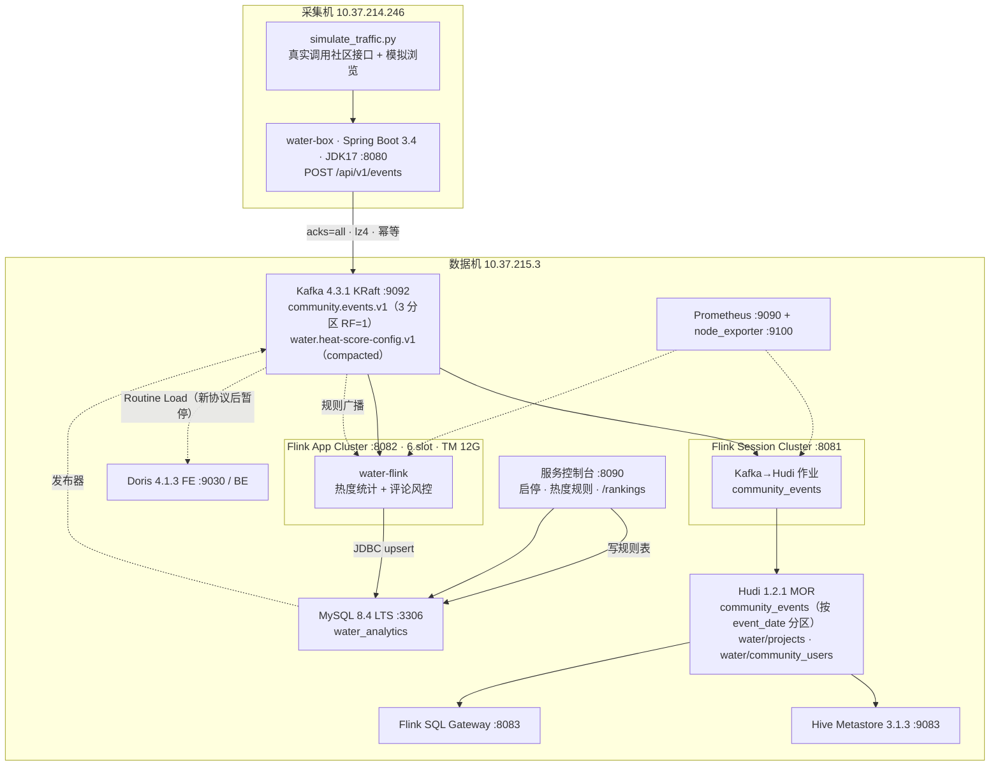

### 2.4 Kafka Topic 与消费组

| Topic / Group | 分区 | 用途 |
| --- | --- | --- |
| `community.events.v1` | 3（RF=1） | 全部埋点事件（唯一入口 topic） |
| `water.heat-score-config.v1` | compact | 热度权重配置广播（完整快照，非 patch） |
| `flink-hudi-community-events-v1` | – | Kafka→Hudi 作业消费组 |
| `water-flink-debug-v1` | – | water-flink 主事件源消费组（当前默认） |
| `water-flink-heat-config-v1` | – | 热度规则广播消费组 |
| `job_events_<uuid>` | – | Doris Routine Load 自动生成的消费组 |

### 2.5 存储与库表

| 存储 | 库 / 表 | 说明 |
| --- | --- | --- |
| MySQL | `water_community` | 业务库（评论、作品、点赞等），`water-box` 与模拟器操作它 |
| MySQL | `water_analytics.heat_score_rule` | 热度规则表（版本号 + 权重 JSON + 状态） |
| MySQL | `water_analytics.user_engagement_stats` | 用户维度窗口结果 |
| MySQL | `water_analytics.project_engagement_stats` | 作品维度窗口结果（含作者、作品名、发布时间） |
| MySQL | `water_analytics.comment_risk_alert` | 评论风控告警表 |
| Hudi | `community_events` | 全量埋点归档，MOR，按 `event_date` 分区 |
| Hudi | `water/projects`、`water/community_users` | 维表（作品 / 社区用户），供 lookup join |
| Hive | `analytics.community_events` | Hive 外表 over Hudi，`event_date` 分区 |
| Doris | `demo.community_events`（早期） | Routine Load 导入目标，**当前按新协议暂停** |

> **路径口径说明**：Hudi 表路径在早期部署时使用本地 `file:///home/daizixin/hudi/...`，
> 后续统一到 HDFS：`hdfs://10.37.215.3:8020/hudi/community_events` 与
> `hdfs://10.37.215.3:8020/hudi/water`（后者也是 water-flink 维表路径的默认值）。
> 若在旧文档（如 `README.md` 阶段 4）看到 `file://` 路径，那是历史阶段的状态。

---

## 3. 端到端数据流：一条埋点的一生

### 3.1 时序图

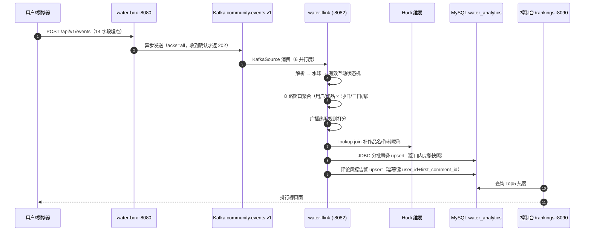

### 3.2 数据流图（含旁路）

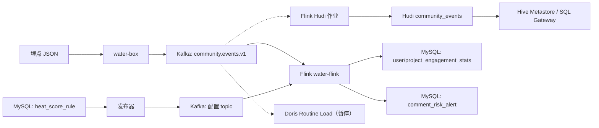

---

## 4. 作业内部算子拓扑

> 入口类：[WaterFlinkApplication.java](file:///home/daizixin/water-flink/src/main/java/com/zongpicha/waterflink/WaterFlinkApplication.java)
> 作业名：`water-flink-engagement-stats`

### 4.0 完整 DAG

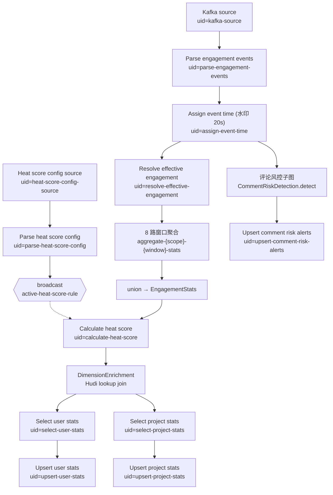

### 4.1 执行环境与 Checkpoint 策略

| 配置 | 值 | 备注 |
| --- | --- | --- |
| 默认并行度 | `FLINK_STATS_PARALLELISM`（6） | 全局，各分支可覆盖 |
| Checkpoint 间隔 | 120 s | EXACTLY_ONCE |
| Checkpoint 超时 | 600 s | |
| 最小间隔 | 30 s | |
| 容忍失败次数 | 3 | |
| 非对齐 Checkpoint | 开启，对齐超时 30 s | 缓解反压下的对齐阻塞 |
| 外部化保留 | `RETAIN_ON_CANCELLATION` | 取消作业也留 checkpoint |
| 状态后端 | RocksDB 增量（集群侧配置） | 见第 9 章优化 ⑥ |

常量：`ALLOWED_LATENESS = 5 min`、`STATS_EMIT_INTERVAL = 1 min`、
`SHANGHAI_DAY_OFFSET = -8h`、`SHANGHAI_WEEK_OFFSET = -80h`。

### 4.2 解析与水印

- **算子**：`Kafka source` → `Parse engagement events`（`EngagementEventParser`）→ `Assign event time`
- **解析**：Jackson 读 JSON；支持 7 个已知 action，其它合法 action 名
  （`[a-z][a-z0-9_]{0,47}`，且带 `project_id` + `author_user_id`）作为**通用 PV** 累加；
  指标计数 `ignored_events`、`malformed_events`。
- **水印**：`forBoundedOutOfOrderness(20s)` + `withIdleness(1min)`，
  时间戳取 `event.getTimestamp()`（13 位毫秒）。
- **Kafka Source 属性**：`commit.offsets.on.checkpoint=true`、
  `partition.discovery.interval.ms=10000`（支持分区自动发现）。

### 4.3 有效互动状态机

- **算子**：`Resolve effective engagement`（`EffectiveEngagementFunction`）
- **类型**：`KeyedProcessFunction<String, EngagementEvent, MetricDelta>`，按 `relationKey()` 分区。
- **relationKey 规则**：

| action | key 形式 |
| --- | --- |
| `like` / `unlike` | `like\|actor\|project` |
| `comment` / `delete_comment` | `comment\|commentId` |
| `follow` | `follow\|actor\|target` |
| `share` | `share\|logId`（**永不去重**，每次转发都算） |
| 其它 | `action\|logId` |

- **状态**：
  - `active-engagement`：`ValueState<Boolean>`，当前关系是否"活跃"
  - `last-relation-event-timestamp`：`ValueState<Long>`，**TTL 30 天**，用于按事件时间丢弃旧的相反事件
- **语义**：乱序时（例如一个很晚才到的 `like` 早于已处理的 `unlike`）会被丢弃，
  保证"取消"不会被已作废的"点赞"重新激活。

### 4.4 八路窗口聚合

由私有方法 `aggregateStats(...)` 生成 8 条**结构完全相同、参数不同**的分支，最后 `union`。

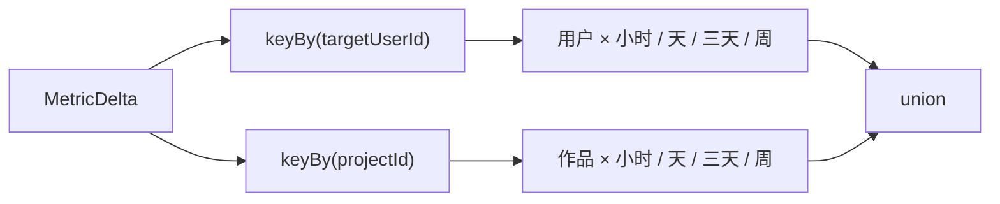

| scope | windowType | code | 窗口定义 | 对齐 |
| --- | --- | --- | --- | --- |
| USER | HOUR | 1 | `of(1h)` | 自然小时 |
| USER | DAY | 2 | `of(1d, -8h)` | 北京时间 00:00 |
| USER | THREE_DAY | 3 | `of(3d, -8h)` | 同上 |
| USER | WEEK | 4 | `of(7d, -80h)` | 北京时间周一 00:00 |
| PROJECT | HOUR | 1 | `of(1h)` | 自然小时 |
| PROJECT | DAY | 2 | `of(1d, -8h)` | 北京时间 00:00 |
| PROJECT | THREE_DAY | 3 | `of(3d, -8h)` | 同上 |
| PROJECT | WEEK | 4 | `of(7d, -80h)` | 北京时间周一 00:00 |

每条分支都挂：

- `trigger(DirtyProcessingTimeTrigger.of(1 min))` —— **只输出有新事件的窗口**（关键优化，见第 9 章 ⑤）
- `allowedLateness(5 min)` —— 迟到 5 分钟内的数据仍会更新窗口
- `aggregate(EngagementAggregateFunction, EngagementWindowFunction(scope, windowType))`

算子命名规则：`Aggregate {scope} {window} stats`，UID `aggregate-{scope}-{window}-stats`，
例如 `aggregate-user-three_day-stats`、`aggregate-project-week-stats`。

### 4.5 热度规则广播分支

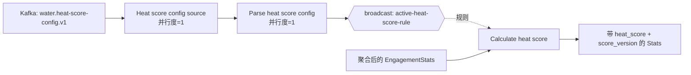

- 配置源从 `earliest` 开始消费，保证重启后能立刻拿到当前生效规则。
- `HeatScoreBroadcastFunction` 逻辑：
  - `processElement`：从广播状态取 `"active"` 规则，**取不到就回退 `HeatScoreRule.DEFAULT`**
    （v1：like 1000 / comment 3000 / share 5000 / follow 4000），
    然后 `setHeatScore(rule.calculate(stats))` 与 `setScoreVersion(rule.getVersion())`。
  - `processBroadcastElement`：**仅当 `version` 严格大于当前版本时才覆盖**，
    同版本或更旧直接忽略（防止旧消息把新规则顶掉）。

### 4.6 维表补齐（DimensionEnrichment）

- **位置**：`scoredStats` 之后，进入 Sink 之前。
- **实现**：`StreamTableEnvironment` + Flink Table API 的 **processing-time lookup join**
  （`FOR SYSTEM_TIME AS OF s.proc_time`），两张 Hudi 维表：

| 维表 | 路径 | Hudi 表名 | 主键 |
| --- | --- | --- | --- |
| `dim_projects` | `{HUDI_DIMENSION_PATH}/projects` | `water_projects` | `id` |
| `dim_community_users` | `{HUDI_DIMENSION_PATH}/community_users` | `water_community_users` | `id` |

- 两表都是 `MERGE_ON_READ`，`lookup.join.cache.ttl = DIMENSION_CACHE_TTL`（默认 10 min）。
- 补齐字段：`project_name`、`project_published_at`（来自作品维表）、
  `user_nickname`（来自用户维表，同一 join 同时解析用户维度与作品维度的作者）。
- 中间算子：`convert-stats-to-rows` / `convert-enriched-rows-to-stats`。
- ⚠️ Hudi connector（`hudi-flink2.0-bundle-1.2.1.jar`）属**集群级依赖**，不在 pom 中。

### 4.7 结果写入（MySQL Sink）

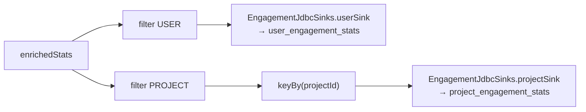

| 项 | 用户 Sink | 作品 Sink |
| --- | --- | --- |
| 目标表 | `user_engagement_stats` | `project_engagement_stats` |
| 算子 | `Upsert user stats` | `Upsert project stats`（前面多一次 `keyBy`） |
| 批次 | 1000 条 / 1000 ms / checkpoint 前 flush | 同 |
| 重试 | 最多 3 次 | 同 |
| 语义 | **at-least-once**（`buildAtLeastOnce` + 批次事务连接） | 同 |
| 时区 | `Asia/Shanghai` | 同 |

**写入 SQL 的三个保护**：

1. 完整快照 upsert（`INSERT ... AS incoming ON DUPLICATE KEY UPDATE`），**不做 `col = col + x`**。
2. `heat_score` 用 `IF(incoming.score_version >= 现存.score_version, incoming, 现存)`，
   `score_version = GREATEST(...)` —— 防止旧版本热度覆盖新版本。
3. 维表列用 `COALESCE`，维表还没补齐时保留旧值不清空。

**运行期规则修正**：`currentRuleQuery` 把 upsert 改写成 `INSERT ... SELECT`，
`LEFT JOIN` 当前生效规则；当输入快照的 `score_version` 落后于数据库当前规则版本时，
用**快照计数 + 数据库当前 weights 重算热度**，避免出现"计数已更新但热度没更新"。

### 4.8 评论风控分支

见第 5 章专章。接入点（保持原统计链路完全不变）：

```java
CommentRiskDetection.detect(engagementEvents, commentRetractWithin,
        commentRiskCount, commentRiskWindow, commentRiskParallelism)
    .sinkTo(CommentRiskJdbcSink.sink(mysqlJdbcUrl, mysqlUser, mysqlPassword))
    .name("Upsert comment risk alerts").uid("upsert-comment-risk-alerts")
    .setParallelism(commentRiskParallelism);
```

---

## 5. 评论风控：双流 Join + CEP 详解

> 源文件：[CommentRiskDetection.java](file:///home/daizixin/water-flink/src/main/java/com/zongpicha/waterflink/function/CommentRiskDetection.java)
> 上线文档：[COMMENT_RISK_UPGRADE.md](file:///home/daizixin/water-flink/deploy/COMMENT_RISK_UPGRADE.md)

### 5.1 业务口径

"发评论 → 很快自己删掉"，单次正常；**同一用户短时间内反复出现**，典型于
刷屏引流、骚扰作者后删证据、试探敏感词。所以规则是"重复才告警"。

### 5.2 子图总览

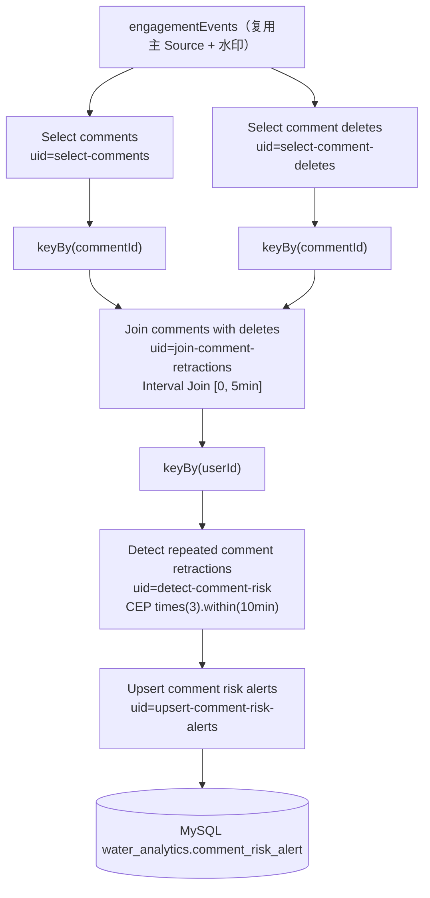

### 5.3 第一步：双流 Interval Join

| 项 | 值 |
| --- | --- |
| 关联键 | 评论流与删除流均 `keyBy(commentId)` |
| 区间 | `.between(Duration.ZERO, retractWithin)`，默认 `[0, 5min]` |
| 含义 | 删除时间 ∈ [评论时间, 评论时间 + 5 分钟] |
| 身份校验 | **删除人必须是评论人本人**（`comment.actorUserId == delete.actorUserId`） |
| 非本人删除 | 计入 counter `comment_foreign_deletes`，直接丢弃（不算撤回） |
| 本人删除 | 计入 counter `comment_retractions`，输出 `CommentRetraction` |
| 侧输出 | 本实现**未使用** side-output，合法性在 process 内过滤 |

`CommentRetraction` 字段：`userId / commentId / projectId / authorUserId / commentedAt / deletedAt`，
`lifetimeMillis() = deletedAt - commentedAt`（评论存活时长）。

### 5.4 第二步：CEP 模式识别

```
Pattern.<CommentRetraction>begin("retract",
            AfterMatchSkipStrategy.skipPastLastEvent())
        .times(riskCount)          // 默认 3
        .within(riskWindow);       // 默认 10 min
CEP.pattern(retractions.keyBy(getUserId), pattern)
   .inEventTime()                  // 事件时间语义
   .process(new RiskAlertFunction());
```

- **按 `user_id` 分区**：同一用户的撤回序列进入同一个模式匹配实例。
- **`skipPastLastEvent()`**：一次连续 6 次撤回只产出 2 条告警（3+3），
  而不是所有重叠组合都告警 —— 避免告警风暴。
- **告警聚合**（`RiskAlertFunction.processMatch`）：
  `retractCount`、`projectCount`、`authorCount`、
  `avgLifetimeMillis = totalLifetime / size`、`maxLifetimeMillis`、`lastDeletedAt`，
  `commentIds` / `projectIds` 逗号拼接。counter `comment_risk_alerts`。
- **状态有界**：Join 状态最多保留 5 分钟，CEP 部分匹配 10 分钟后清除。

### 5.5 第三步：告警落库

| 项 | 值 |
| --- | --- |
| 表 | `water_analytics.comment_risk_alert` |
| 幂等键 | 主键 `(user_id, first_comment_id)` |
| 语义 | at-least-once，重放幂等覆盖同一行 |
| 批次 | 200 条 / 1000 ms / 重试 3 次 |
| 时区 | `Asia/Shanghai` |

查询示例：

```sql
SELECT user_id, retract_count, project_count, avg_lifetime_ms,
       first_comment_at, last_deleted_at, comment_ids
FROM water_analytics.comment_risk_alert
WHERE last_deleted_at >= NOW() - INTERVAL 1 HOUR
ORDER BY last_deleted_at DESC;
```

### 5.6 流量画像（上线前采样）

| 指标 | 值 |
| --- | --- |
| 10 分钟事件量 | 28,867 条 |
| 删评次数 | 787 次（全部能在 10 分钟内匹配到本人评论） |
| 存活时长 | p50 204 ms / p90 310 ms / max 615 ms |
| 10 分钟内撤回 ≥3 次的用户 | 7 个 |

结论：5 分钟 Join 上界余量充足，3 次/10 分钟阈值预期每 10 分钟几条告警。

---

## 6. 热度规则版本化机制

### 6.1 端到端链路

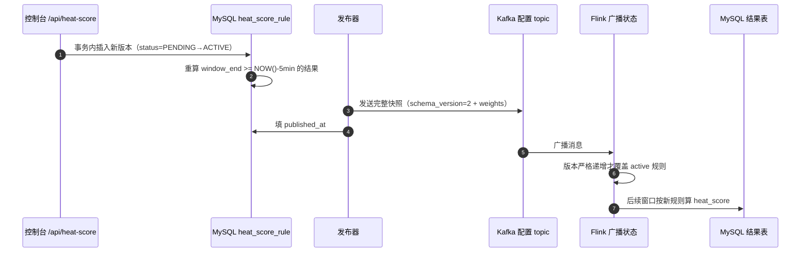

### 6.2 规则消息格式

```json
{
  "schema_version": 2,
  "version": 4,
  "weights": {
    "like": 1000,
    "comment": 3000,
    "share": 5000,
    "follow": 4000,
    "view_page": 100
  }
}
```

- 权重是**千分位整数**（显示层 1 / 3 / 5 / 4 / 0.1）。
- 公式：`heat_score = Σ(指标累计值 × 权重)`；缺的计数按 0，未配置的指标不贡献。
- MySQL 的权威配置是 `heat_score_rule.weights` JSON，不再为每个指标加物理权重列。
- 版本必须递增；同版本与更旧的消息不会覆盖已启用规则。
- 新版仍能读旧格式消息与旧 savepoint 里的规则。

### 6.3 控制台接口

```json
{"weights":{"like":1,"comment":3,"share":5,"follow":4,"view_page":0.1},"note":"说明"}
```

校验：1–64 个合法指标、有限非负权重、最多三位小数、
两个结果表都有对应的 BIGINT `<metric>_count` 列。

⚠️ **没有 Kafka 发布，直接改 MySQL 不会让运行中的 Flink 自动刷新。**

### 6.4 新增一个指标（标准动作）

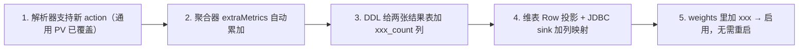

第 3、4 步是**持久化变更**，需要构建 + 状态恢复升级；
第 5 步只是配置，广播热更新即可。

若新指标需要 UV / 时长求和 / 撤销 / 去重 / 新归属关系，**必须先实现它的统计语义**，
不能当作普通 PV 计数。

---

## 7. 存储分层与下游消费

### 7.1 分层图

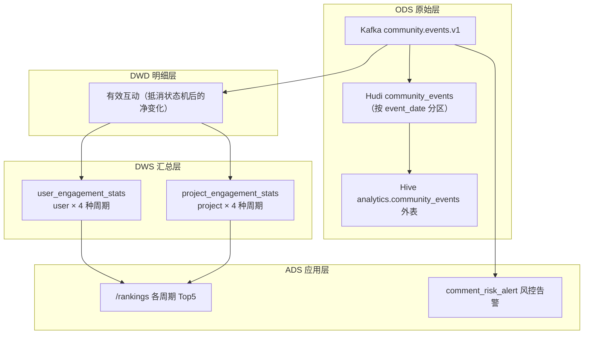

### 7.2 MySQL 表结构要点

| 表 | 主键 | 关键索引 | 保留 |
| --- | --- | --- | --- |
| `user_engagement_stats` | `(window_type, window_start, user_id)` | `idx_user_history`、`idx_user_window_heat` | 小时 24h / 天 7d / 三天 18d / 周 8 周 |
| `project_engagement_stats` | `(window_type, window_start, project_id)` | `idx_project_history`、`idx_project_author_window`、`idx_project_window_heat` | 同 |
| `heat_score_rule` | `version` | `uk_heat_score_rule_active`（生成列保证唯一 ACTIVE） | 永久 |
| `comment_risk_alert` | `(user_id, first_comment_id)` | `idx_comment_risk_alert_time` | 永久 |

> **"窗口本身就是版本"**：今天的窗口持续 upsert，昨天/前天的行自然保留为兜底。
> 保留策略由 MySQL Event Scheduler `cleanup_engagement_stats`（每 1 小时）执行。

### 7.3 Hudi / Hive / Doris

| 项 | 现状 | 备注 |
| --- | --- | --- |
| Hudi | MOR 表，主键 `log_id`，按 `event_date` 分区，保留 `raw_event` 原文 | 未设 ordering 字段，目前按提交时间排序 |
| Hive | `analytics.community_events` 已注册，**未开 hive_sync** | 分区需手工注册（见 9 章 ⑦） |
| Doris | 单 FE / 单 BE，早期 Routine Load 目标 | 新协议后 `job_events` 暂停，需按新字段重建 |

---

## 8. 部署、升级与回滚

### 8.1 部署形态

- **Standalone Application Cluster**，systemd 管理：
  `water-flink-jobmanager` / `water-flink-taskmanager`。
- JAR：[`/home/daizixin/flink-apps/water-flink/app/water-flink.jar`](file:///home/daizixin/flink-apps/water-flink/app/water-flink.jar)
- 恢复参数放在 systemd drop-in：`/etc/systemd/system/water-flink-jobmanager.service.d/restore.conf`
  （由 `deploy/*-restore.conf` 拷贝而来）。
- 资源：**6 slot 已满，TaskManager 12 GB**。

### 8.2 标准升级流程（stop-with-savepoint）

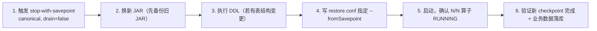

### 8.3 回滚

对当前作业再做一次新 Savepoint → 换回备份 JAR → 用
`--allowNonRestoredState` 从该 Savepoint 恢复（新算子状态需要丢弃）。

> `--allowNonRestoredState` 是**丢弃无法映射的状态**，不是修复兼容性。

### 8.4 已有备份与 savepoint 记录

| 场景 | 备份 JAR | Savepoint |
| --- | --- | --- |
| view_page 指标升级 | – | `savepoint-99c4f6-713cc62de21d` |
| JDBC 批次事务 | – | `savepoint-dca8e1-1500c01ad03f` |
| 评论风控 | `water-flink-before-comment-risk-20261020.jar` | `savepoint-59ca69-73c82a6dad30` |
| Git 发布 | `water-flink-before-git-release-20261020.jar` | `savepoint-62995b-80b1f288a333` |

### 8.5 兼容性边界（务必先读）

| 变更 | 恢复建议 |
| --- | --- |
| 仅换权重、加已有指标的公式项 | 广播热更新，不恢复不重启 |
| 加结果表列、改无状态 sink 映射 | 通常可恢复；**DDL 必须先完成** |
| POJO 加字段，类名与旧字段类型不变 | 序列化器支持 schema evolution；旧值新字段为 null/0 |
| 加新状态描述符 | 一般从空状态开始 |
| 改并行度 | 在支持重分布、maxParallelism 兼容时可 |
| 改 UID / 状态名 / 包类名 / 不兼容字段类型 | **不能假定可恢复**，需迁移 + 实测 |
| 改 keyBy / key 类型 / hash / maxParallelism | 涉及状态分区，需专门迁移 |
| 改窗口长度 / 时区 / 统计定义 / 过滤去重语义 | 可反序列化但口径错误，应重放重算 |
| 删有状态算子 | 默认无法映射，`allowNonRestoredState` 是丢状态 |
| 状态文件被清理 / Kafka offset 超保留期 | 不能保证完整恢复 |

---

## 9. 问题与优化编年史（重点）

> 每一条都按 **现象 → 根因 → 处理 → 验证** 记录，可直接作为面试案例。

### ① 100 QPS 压测全超时：日志写终端

- **现象**：100 QPS 下请求全部超时。
- **根因**：400 个 Tomcat 线程全部阻塞在往 IDE 终端写逐条 INFO 日志。
- **处理**：把逐条埋点日志改写到 logback 滚动文件 `logs/events.log`（100 MB × 7 天）。
- **验证**：500 条 / 5 秒全部成功。

### ② 压测吞吐上不去：短连接 + 作品池膨胀

- **现象**：`urllib` 最高仅约 1,550–1,700 QPS；跑到 63 万条降到 600 QPS。
- **根因**：① 短连接开销大；② 同时跑了两个模拟器进程；③ 作品池不断变大，每条事件都要遍历全池做加权抽样。
- **处理**：改用 `aiohttp` 长连接；活跃作品池**固定为 1 万**。
- **验证**：2,000 QPS，6,000 条 3.00 秒发完，失败 0。

### ③ 跨机写 Kafka 失败：advertised.listeners 是 localhost

- **现象**：应用能连上 `10.37.215.3:9092`，随后却去连 `localhost:9092` 失败。
- **根因**：Broker 的 `advertised.listeners` 仍是 `localhost`。
- **处理**：改为 `PLAINTEXT://10.37.215.3:9092,CONTROLLER://10.37.215.3:9093` 并重启。
- **验证**：`kafka-describe` / 远端客户端连通。
- 配置文件：`/home/daizixin/kafka/config/server.properties`。

### ④ Kafka 重启报 9093 端口占用

- **现象**：`Socket server failed to bind to 0.0.0.0:9093: Address already in use`。
- **根因**：旧进程尚未退出。
- **处理**：等端口释放，先前台启动确认 `Kafka Server started`，再切后台。

### ⑤ Kafka KRaft 环境坑

- **现象/坑**：4.x 配置文件在 `config/server.properties`（**没有** `config/kraft/`）；`kafka-storage.sh format` 必须加 `--standalone` 且**只能执行一次**。
- **处理**：集群 ID 保存在 `kafka/data/meta.properties`，后续**绝不再 format**。

### ⑥ Flink 版本选型：2.3 没有可用 Hudi

- **现象**：装了 Flink 2.3.0 后发现无法接 Hudi。
- **根因**：Hudi 1.2.1 只支持 Flink 1.17~1.20 / 2.0 / 2.1。
- **处理**：卸载改装 **Flink 2.0.2**（安装包 SHA-512 校验），配 Java 17。

### ⑦ Hudi 作业 checkpoint 失败：状态超过内存上限

- **现象**：`Size of the state is larger than the maximum permitted memory-backed state`。
- **根因**：默认 JobManager 内存型 checkpoint，单状态上限 5 MB。
- **处理**：改用 FileSystem checkpoint `/home/daizixin/flink-state/session-cluster/{checkpoints,savepoints}`，超时 5 min。

### ⑧ Hudi 作业 OOM：`HoodieAvroDataBlock.serializeRecords`

- **现象**：写入阶段 OOM。
- **根因**：只有一个 writer，每 10 秒 checkpoint 一次，heap 仅 1.43 GB。
- **处理**：并行度 1→4、compaction 2；writer 256 MB / batch 64 MB / log block 64 MB；缓冲改 MANAGED；checkpoint 60 s；TaskManager 4 G→12 G。

### ⑨ water-flink checkpoint 超时 + 反压 99.9%

- **现象**：checkpoint 超时，反压 99.9%。
- **根因**：8 路窗口在 **Heap 状态**下做全量快照，状态 80~100 MB，而并行度只有 1。
- **处理**：改用 **RocksDB 增量 checkpoint**；间隔 120 s、超时 600 s、容忍失败 3 次；新建消费组 `water-flink-stats-v2` 从 earliest 重建。
- **验证**：反压解除，checkpoint 恢复正常。

### ⑩ 写放大：每分钟输出全部快照 → 数千万次 upsert

- **现象**：修复 checkpoint 后吞吐仍追不上，lag 一度到 1424 万。
- **根因**：8 条窗口链每分钟把**所有窗口**的输出都发一遍，放大成数千万次 MySQL upsert。
- **处理**：新增 **`DirtyProcessingTimeTrigger`**（只输出有新事件的"脏"窗口）；并行度 2→6；JDBC 批量 1000。
- **验证**：lag 从 1424 万降到 1070 万并持续追赶。

### ⑪ savepoint 恢复后连环 RESTARTING：trigger 状态类型不兼容

- **现象**：从 savepoint 恢复后作业反复 RESTARTING。
- **根因**：trigger 状态类型从 `REDUCING` 改成了 `VALUE`，与旧状态不兼容。
- **处理**：修复状态兼容（保留旧状态名 `fire-time` 的读取）后，从**新 savepoint** 恢复。
- **沉淀**：见第 8.5 节兼容性边界表。

### ⑫ 排行榜 API 超时：2.15M 行全量排序

- **现象**：`/rankings` 接口 10 s+ 超时。
- **根因**：`MAX(window_start)` + `ROW_NUMBER()` 导致全表排序。
- **处理**：新增索引 `(window_type, score_version, window_start DESC, heat_score DESC, project_id)`，查询改为按索引直接 `LIMIT 5`。
- **验证**：耗时 10 s+ → **0.91 s**。

### ⑬ Managed Memory 一直 100%

- **现象**：监控显示 Managed Memory 常年 100%。
- **根因**：RocksDB 会**预占**整个 managed 池，属正常现象，不是泄漏。
- **处理**：TaskManager 8 G→12 G；重启次数用 `systemctl show -p NRestarts` 观察。

### ⑭ 新增 view_page 指标：状态演进验证

- **做法**：为"指标可扩展"引入 `weights` JSON + 通用 `extraMetrics`。
- **验证**：`StateEvolutionTest` 用 `-Dprevious.jar=<旧部署JAR>` 生成旧序列化快照，
  在新类下读取，确认**旧计数保留、新字段为空**。
- **命令**：`mvn test -Dprevious.jar=/path/to/previous-water-flink.jar`

### ⑮ JDBC 批次事务：从逐条提交到整批提交

- **问题**：原实现每条记录一次自动提交，事务次数过多。
- **处理**：连接建立/重连后 `autoCommit=false`，`executeBatch` 成功后统一 `commit`，
  提交成功才允许 Flink 清空批次缓存；半批失败则整批 rollback + 新连接重放，最多 3 次。
- **仍然的约束**：at-least-once，不是 XA/exactly-once；
  提交成功但响应丢失会重放整批；两张表各自提交，**不保证跨表原子**。
- **验证**：`BatchTransactionConnectionProviderTest` 5 例 + 真连 MySQL 的
  `BatchTransactionMysqlTest`（隔离表，含 300 行基准对比）。

### ⑯ 规则版本的"晚到广播"问题

- **现象风险**：MySQL 已按新规则重算，但基于旧广播版本的结果**晚到**，会把热度写回去。
- **处理**：JDBC INSERT 改成 `INSERT ... SELECT`，读当前生效规则；
  快照版本落后时用**当前 weights 重算**再写入；同时 `score_version` 用 `GREATEST` 保护。
- **代价**：每次写入多一次单行配置读取，且 `INSERT SELECT` 可能减少驱动批次合并，
  **大吞吐场景需单独压测**（已知取舍）。

### ⑰ Hive/Hudi：未开 hive_sync，分区要手工注册

- **现象**：Flink Hudi sink 没开 `hive_sync`，Hive 里查不到新分区。
- **根因**：`hudi-flink2.0-bundle-1.2.1.jar` **缺少 Hive client 类**，
  不能只靠加 SQL option 打开。
- **处理**：手工注册分区 —— 2026-10-17 一次性注册了 **365 个未来分区**
  （`event_date` 2026-10-18 ~ 2027-10-17），验证后共 370 个分区、未来分区可查但为空。
- **若要真开 hive_sync**：需补 Hive 2.3.10 相关依赖、验证依赖冲突并重启 Flink。

### ⑱ Hive 聚合 Hudi 报 `IndexOutOfBoundsException`

- **现象**：`count(*)` 在 MR/Hudi reader 路径下抛异常。
- **处理**：用 **session 级 `HiveInputFormat` 覆盖**临时修复 2026-10-17 分区的 count(*)；
  但**全表或更早分区聚合仍会异常**，需先做分区/schema 兼容排查再依赖聚合查询。

### ⑲ Doris Routine Load 暂停

- **现象**：`job_events` 处于 PAUSED。
- **根因**：埋点换成新协议后 JSON 映射不匹配（早期按 `eventId/eventType/...` 解析）。
- **遗留**：表结构与 jsonpaths 需按新字段重建。
- **关联坑**：Kafka 只有 3 个分区，而 Routine Load 导入并发配了 256，**配置与负载不匹配**。

### ⑳ 评论风控上线：内存受限下的加法

- **约束**：不新增作业、不新增 slot、不改 TaskManager 内存。
- **做法**：作为**新分支**加入原作业，复用主 Kafka Source 与水印；
  复用集群 `lib/` 已自带的 `flink-cep-2.0.2.jar`（pom 中声明 provided）；
  Join 状态上界 5 min、CEP 部分匹配 10 min 清除。
- **上线**：原作业 `59ca695...` → savepoint → 新 JAR → 从 savepoint 恢复 → 新作业 `62995be...`。
- **验证**：18/18 顶点 RUNNING；新 checkpoint 约 2 秒、state ≈ 464 MB（与升级前同量级）；
  10 分钟自然流量产生 **322 次 Join 匹配、5 条告警**，评论存活 137–240 ms。
- **回滚**：备份 JAR + `--allowNonRestoredState`。

### ㉑ 流量模拟器从"造假"到"真调接口"

- **问题**：早期模拟器直接生成伪造数据，无法验证端到端真实链路。
- **处理**：改为**真实调用 `water_community` 接口**：总 100 QPS，
  50% 浏览（仅本地模拟、不发埋点），点赞/评论/关注/转发**真实调用**；
  点赞/评论各有 10% 概率触发取消/删除，删除用接口返回的真实评论 ID。
- **约束**：写请求失败**不自动重试**，避免重复创建或反向切换状态。
- **验证**：9 项功能测试通过；线上 100 次真实请求全部成功，核对数据库与埋点一致。

### ㉒ HiveServer2 无法启动

- **现象**：HiveServer2 3.1.3 在 JDK 11/17 上启动失败（`URLClassLoader` 强制转换缺陷）。
- **处理**：需 JDK 8 或 Hive 4，**尚未完成**（当前通过 Flink SQL Gateway 走查询）。

---

## 10. 监控与告警

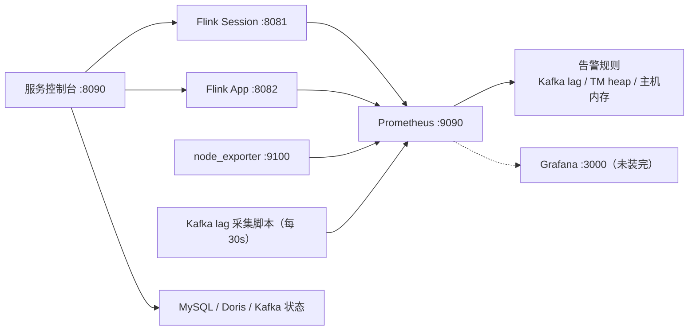

| 采集项 | 方式 | 端口 |
| --- | --- | --- |
| Flink 指标 | Prometheus reporter（两套集群） | 9249–9252 |
| 主机指标 | node_exporter | 9100 |
| Kafka lag | textfile 脚本，每 30 s | – |
| 服务状态 | 自研控制台，每 5 s 刷新 | 8090 |

已配告警：Kafka lag、TaskManager heap、主机内存。Grafana 尚未安装完成。

---

## 11. 测试体系

| 测试类 | 覆盖 |
| --- | --- |
| `CommentRiskDetectionTest` | 3 例：命中告警 / 慢删与稀疏不告警 / 突发不重叠告警 |
| `EffectiveEngagementFunctionTest` | 5 例：PV 合并、乱序 like 丢弃、点赞切换、旧 unlike 丢弃、share 不去重 |
| `EngagementAggregateFunctionTest` | 1 例：单窗口净变化聚合 |
| `EngagementEventParserTest` | 4 例：view_page/download、作者归属、follow、忽略无关 action |
| `HeatScoreRuleTest` | 4 例：动态权重、拒绝非法输入、旧格式兼容 |
| `StateEvolutionTest` | 1 例：用 `-Dprevious.jar` 验证状态 schema 演进 |
| `WindowAlignmentTest` | 3 例：日/三天/周窗口按上海时区对齐 |
| `BatchTransactionConnectionProviderTest` | 5 例：批次/定时/checkpoint flush、半批回滚重放、提交响应丢失、永久失败 |
| `BatchTransactionMysqlTest` | 1 例（`VERIFY_MYSQL_SINK=1`）：真连 MySQL 事务与基准 |
| `HeatRuleSinkTest` | 1 例（`VERIFY_MYSQL_SINK=1`）：旧规则快照的插入/更新保护 |

需要真连 MySQL 的测试通过环境变量 `VERIFY_MYSQL_SINK=1` 开启，
使用 `MYSQL_SINK_TEST_TABLE`（须匹配 `flink_sink_batch_verify_[0-9]+`）作为隔离表。

---

## 12. 已知风险与后续规划

| 优先级 | 事项 |
| --- | --- |
| 高 | Doris Routine Load `job_events` 仍按旧协议暂停，需按新埋点字段重建表与导入任务 |
| 高 | 数据落在单机（Hudi / checkpoint）；生产化需迁到 HDFS/MinIO/S3 并做 HA |
| 高 | Hive 聚合 Hudi 路径仍不稳定（`IndexOutOfBoundsException`），需分区/schema 兼容排查 |
| 中 | Grafana 未安装；HiveServer2 需 JDK 8 或 Hive 4 |
| 中 | Hudi 未设 ordering/precombine 字段，目前按提交时间排序；如需按事件时间合并应改 `timestamp` |
| 中 | Doris `priority_networks=127.0.0.1/32` 只能本机注册 BE，多机需用内网 IP 重部署 |
| 中 | 控制台无登录认证、Doris root 空密码，仅适合可信内网 |
| 中 | JDBC `INSERT SELECT` 保护增加写放大，大吞吐需压测 |
| 低 | water-box 目前是 HTTP，上公网需 TLS 或反向代理 |
| 规划 | Session Guardian（智能客服全生命周期实时风控与归因）设计稿已完成：`docs/session-guardian-design.md` |

---

## 附录 A：环境变量清单

| 环境变量 | 默认值 | 必填 |
| --- | --- | --- |
| `KAFKA_BOOTSTRAP_SERVERS` | `10.37.215.3:9092` | 否 |
| `KAFKA_TOPIC` | `community.events.v1` | 否 |
| `KAFKA_GROUP_ID` | `water-flink-debug-v1` | 否 |
| `KAFKA_STARTING_OFFSETS` | `latest`（仅 earliest/latest） | 否 |
| `HEAT_CONFIG_TOPIC` | `water.heat-score-config.v1` | 否 |
| `HEAT_CONFIG_GROUP_ID` | `water-flink-heat-config-v1` | 否 |
| `MYSQL_JDBC_URL` | — | **是** |
| `MYSQL_USER` | — | **是** |
| `MYSQL_PASSWORD` | — | **是** |
| `HUDI_DIMENSION_PATH` | `hdfs://10.37.215.3:8020/hudi/water` | 否 |
| `DIMENSION_CACHE_TTL` | `10 min` | 否 |
| `FLINK_STATS_PARALLELISM` | `6` | 否 |
| `COMMENT_RETRACT_WITHIN` | `5 min` | 否 |
| `COMMENT_RISK_COUNT` | `3`（<2 报错） | 否 |
| `COMMENT_RISK_WINDOW` | `10 min` | 否 |
| `FLINK_COMMENT_RISK_PARALLELISM` | `2` | 否 |

测试专用：`VERIFY_MYSQL_SINK=1`、`MYSQL_SINK_TEST_TABLE`、`-Dprevious.jar`。

## 附录 B：算子 UID 清单（升级兼容的关键）

```
kafka-source                       Kafka source
parse-engagement-events            Parse engagement events
assign-event-time                  Assign event time
resolve-effective-engagement       Resolve effective engagement
aggregate-{scope}-{window}-stats   Aggregate …（8 条）
heat-score-config-source           Heat score config source
parse-heat-score-config            Parse heat score config
calculate-heat-score               Calculate heat score
convert-stats-to-rows              DimensionEnrichment 入
convert-enriched-rows-to-stats     DimensionEnrichment 出
select-user-stats / upsert-user-stats
select-project-stats / upsert-project-stats
select-comments / select-comment-deletes
join-comment-retractions           Join comments with deletes
detect-comment-risk                Detect repeated comment retractions
upsert-comment-risk-alerts         Upsert comment risk alerts
```

## 附录 C：文件索引

| 文件 | 说明 |
| --- | --- |
| [README.md](file:///home/daizixin/water-flink/README.md) | 双机平台搭建总结（2026-10-12 ~ 10-14），全局背景 |
| [HEAT_RULES.md](file:///home/daizixin/water-flink/HEAT_RULES.md) | 热度指标口径、weights 公式、兼容性边界、批次事务 |
| [docs/session-guardian-design.md](file:///home/daizixin/water-flink/docs/session-guardian-design.md) | 智能客服 Session Guardian 设计稿 |
| [deploy/COMMENT_RISK_UPGRADE.md](file:///home/daizixin/water-flink/deploy/COMMENT_RISK_UPGRADE.md) | 评论风控上线与回滚文档 |
| [deploy/BATCH_TRANSACTION_UPGRADE.md](file:///home/daizixin/water-flink/deploy/BATCH_TRANSACTION_UPGRADE.md) | JDBC 批次事务升级记录 |
| [sql/001_engagement_stats.sql](file:///home/daizixin/water-flink/sql/001_engagement_stats.sql) | 建库 + 规则表 + 两张结果表 |
| [sql/002_dimension_columns.sql](file:///home/daizixin/water-flink/sql/002_dimension_columns.sql) | 维表列（作品名 / 作者昵称 / 发布时间） |
| [sql/003_flexible_heat_metrics.sql](file:///home/daizixin/water-flink/sql/003_flexible_heat_metrics.sql) | `view_page_count` + `weights` JSON |
| [sql/004_comment_risk_alert.sql](file:///home/daizixin/water-flink/sql/004_comment_risk_alert.sql) | 风控告警表 |
| [WaterFlinkApplication.java](file:///home/daizixin/water-flink/src/main/java/com/zongpicha/waterflink/WaterFlinkApplication.java) | 作业入口与算子拓扑 |

---

*文档结束。本文由代码库现状 + 历史运维记录整理，如与代码冲突以代码为准。*
